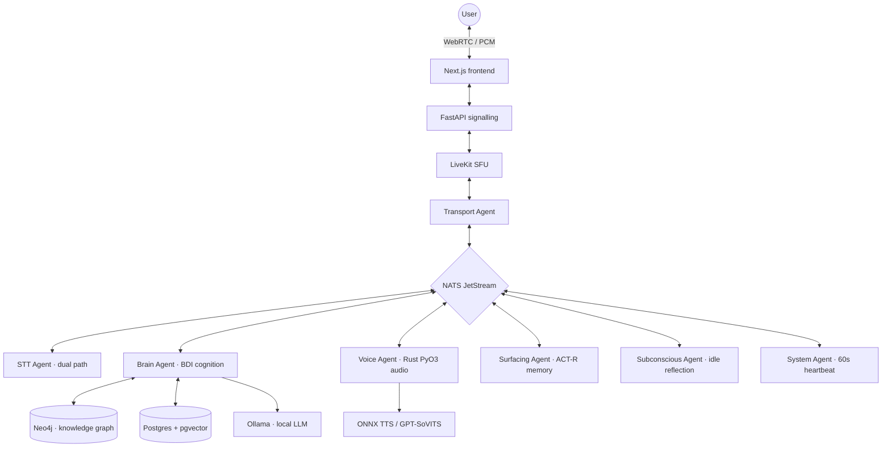

This is the most ambitious thing I have built and the one I am most careful about describing, for a reason I'll get to at the end.

AI Friend is a cognitive voice system. Not a chatbot with a text-to-speech layer bolted on — a mesh of eight autonomous agents communicating over a hardened signal bus, where personality, emotional state and relationship history persist across restarts, and where the timing of a pause is treated as part of the response rather than an artefact of it.

## The premise

A technically correct answer delivered with unnatural timing, or one that has forgotten the emotional context of the last two minutes, is a *behavioural* failure even when it is a linguistic success. That framing is what the whole architecture serves.

| | Reactive chatbot | Sovereign mesh (CVS-3.5) |
| :--- | :--- | :--- |
| Cognitive loop | Synchronous request-response | Asynchronous event-driven |
| State | Session-based / stateless | Persistent / self-maturing |
| Emotion | Prompt-driven labels | Deterministic mathematical drift (PAD) |
| Timing | Playback delay | Physically injected PCM silent buffers |
| Memory | Passive search (RAG) | Proactive activation (ACT-R) |
| Topology | Centralised API | Decentralised local mesh |

The row that matters most is emotion. Asking a model to "respond happily" produces a performance of happiness. Instead, affect here is a **state vector** — pleasure, arousal, dominance — that drifts according to appraisal maths and then modulates the language model's own generation parameters. The model doesn't decide how it feels. It is told.

## The mesh

**NATS JetStream** is the nervous system. Every agent publishes and subscribes to typed Pydantic contracts on nine core subjects; no agent calls another directly.

<StatRow>
  <Stat value="8" label="Autonomous agents" />
  <Stat value="9" label="Typed bus subjects" />
  <Stat value="4" label="Rust crates" />
  <Stat value="1,266 MB" label="Measured idle footprint" />
</StatRow>

Each agent has one job. The **Brain Agent** runs the BDI decision loop. The **Surfacing Agent** does ACT-R episodic retrieval and proactive recall — it volunteers a memory rather than waiting to be asked. The **Subconscious Agent** generates internal monologue during idle periods. The **Pulse Agent** emits a heartbeat every 60 seconds that triggers maturation cycles across the mesh.

## Why parts of it are written in Rust

The audio path started in Python and the Python interpreter was the wrong tool for it. CVS-3.5 moved the signal mesh into native Rust crates — `contracts`, `cognitive-rust`, `stt-agent` and `voice-agent` — bridged back through PyO3.

The Voice Agent is where that pays off. It embeds ONNX Runtime with dynamic execution provider binding (TensorRT/CUDA on NVIDIA, CoreML on Apple Silicon, CPU fallback), which removes an HTTP hop that used to sit in the middle of the audio path. It segments speech into seven-word chunks to preserve prosodic context, uses overlap-add crossfading so streaming PCM chunks join without a click, and injects speculative fillers — *hmm*, *um* — if decision latency exceeds 250 ms, keeping the conversation alive while the real audio is prepared behind it.

<Callout type="insight">
Pauses are injected as actual silent PCM buffers, not text tags handed to a TTS engine. A tag asks the synthesiser to interpret a pause; a buffer *is* the pause. The difference is audible.
</Callout>

## Interruption, in three stages

Being interrupted is the hardest part of duplex conversation. Audio is fanned out to two speech recognition paths simultaneously — a fast speculative one and an accurate one — and interruption is arbitrated across three stages:

1. **Reflexive soft-attenuation.** The fast path publishes a speculative stop the moment it sees an interruption marker. The Voice Agent ducks volume by 70% within 10 ms so duplex listening is possible. Partials are only emitted once the endpointer confirms speech, so a cough can't trigger it.
2. **Symbolic validation.** The Brain Agent evaluates the speculative text. Confirmed, it commits a hard stop, aborting both playback and LLM generation. Rejected as noise, it publishes a resume and volume ramps smoothly back to 100%.
3. **Resolution.** The accurate path's final transcript arrives and the Brain Agent runs a full cognitive turn.

## The cognitive models

This is the research half of the project, and each piece maps to published work rather than being invented:

<TechGrid
  groups={[
    { label: "Affect", items: ["PAD state space", "ALMA drift dynamics", "OCC / Lazarus appraisal", "Cortisol & dopamine coupling"] },
    { label: "Memory", items: ["ACT-R activation", "ACT-R pruning", "pgvector episodic recall", "Neo4j semantic graph"] },
    { label: "Decision", items: ["BDI loop", "MAUT utility scoring", "Behaviour trees", "Marsh trust matrix"] },
  ]}
/>

Emotional state is not sampled per turn — it drifts continuously and modulates the language model's generation parameters directly. Memory is not retrieved by similarity alone; ACT-R activation weights recency and frequency so that what surfaces is what a person would plausibly have *thought of*, not merely what scores highest against the query vector.

One detail I like: somatic response is **learned, and starts empty**. Recognising a comfort object lifts valence and arousal only for objects the agent has actually learned about. A fresh agent recognises nothing and no spike fires. That cold start is deliberate — no comfort vocabulary is hardcoded, because a hardcoded one would be mine, not the agent's.

## The part that matters most: saying what isn't true yet

Here is the thing I'd want someone to take away from this project.

I benchmarked CVS-3.5 against seven other systems across eight dimensions. Some of those numbers are real: cognitive gating latency at **5.44 ms**, memory Recall@5 at **87.5%** across 88 probes, theory-of-mind MAE at **0.032 valence / 0.041 arousal** across 1,000 samples, 1,266 MB idle footprint for the full eight-agent mesh plus its database stack, 0.99 W active edge power.

And some of them are not measurements at all, so the table says so explicitly:

<Callout type="warning">
Several headline figures are **composed estimates** — sums of independently measured sub-components, not live end-to-end stopwatch trials — and the table marks them as such. Speech-to-speech time-to-first-token, memory scaling complexity, and total perceived end-to-end latency are listed as *not yet measured*, because no live end-to-end harness exists.
</Callout>

The STT agent is the sharpest example. Both backends compile, link and pass the crate's unit tests including cross-language wire-shape tests. But **no audio has been transcribed end to end**, and no acoustic emotion has been classified on a live utterance. So accuracy and latency are documented as unmeasured rather than estimated, and the agent registry carries a warning marker next to that row.

Getting there required deleting things. A prior latency figure attributed to LLM inference turned out to be mislabelled — it was memory-retrieval latency — and was retracted. A benchmark fallback that silently fabricated latency-scaling numbers was changed to fail loudly instead. Four of the seven comparison sources were formatted as academic papers when they are vendor product materials, and are now listed as what they are.

<Callout type="insight">
It is genuinely tempting to leave an impressive-looking number in a table nobody will check. The reason I didn't is that the first person to check it would have been me, six months later, building on top of it.
</Callout>

## Where it runs

Three hardware tiers are supported, from a 4-core CPU-only evaluation setup at 8 GB, through an 8-core / RTX 3060 / 16 GB real-time configuration, up to a 16-core research tier. The stack composes as `light`, `heavy`, `infra` and `prod` profiles.

The Vision Agent is the honest exception to the containerised design. On Windows and macOS it must run on the host, and that isn't a configuration gap — it was verified empirically. Inside a Linux container there is no `/dev/video*`, the daemon rejects the device flag, `/tmp/.X11-unix` is absent with `DISPLAY` unset, and `mss` fails outright. On a Windows or macOS host the container runs in a Linux VM with no route to the display or webcam. No configuration resolves it, so it is excluded from the default stack and gated behind a profile instead of pretending.

The agent probes capture at startup and logs prominently when it is blind, and its healthcheck reads a sentinel touched on each successful capture rather than checking that the process exists — which passes just as happily when every frame returns `None`.

## What I learned

The engineering lesson is that a typed message bus with strict contracts made an eight-agent system tractable in a way direct calls never would have. Agents can be restarted, replaced or run on a different host without anything else knowing.

The other lesson is about documentation. This README is longer than most of the code files it describes, and a large fraction of it is caveats. That felt like weakness while writing it. It is the opposite: it is the only version of the document that stays true as the project changes.
