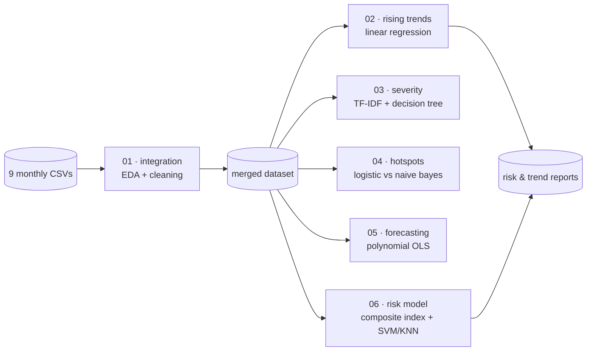

This started as a coursework-shaped question — *can you find something useful in nine months of crime records?* — and turned into the project that taught me the most about what a model is actually claiming.

The dataset is monthly crime records from January to September 2025. The pipeline is six Python scripts, run in order, each producing artefacts the next one consumes.

<StatRow>
  <Stat value="9" label="Monthly datasets merged" />
  <Stat value="6" label="Sequential analysis stages" />
  <Stat value="7" label="Models trained and compared" />
</StatRow>

## The pipeline

Numbered scripts, no orchestration framework, no DAG. For a nine-file dataset that would have been ceremony. You run them in order and each one prints what it found.

**Stage 1** merges the nine CSVs, strips empty columns, standardises names, adds `MONTH_NAME` and `MONTH_INDEX`, then handles missing values — `Unknown` for text, `0` for numerics — and drops duplicates. It also engineers a `SEVERITY` label from keywords where none exists: murder is high, theft is medium, and so on.

**Stage 2** aggregates counts by crime type and month, filters out anything occurring fewer than ten times so noise doesn't dominate, then fits a simple linear regression per crime type with month as X and count as y. The slope is the trend. Anything above 0.5 raises a console alert.

**Stage 3** vectorises crime descriptions with **TF-IDF** and trains a decision tree to map those features to the severity label. I picked a decision tree over something more accurate deliberately — I wanted to read the top words driving each classification, and a tree tells you. Evaluation is accuracy, precision, recall, F1 and a confusion matrix.

**Stage 4** defines a hotspot as a count above the median monthly count, then trains **logistic regression** and **multinomial naive Bayes** on TF-IDF features plus month index, and compares them by ROC-AUC. Logistic regression's coefficients double as an explanation of which factors push a crime type into the high-frequency class.

**Stage 5** forecasts next month's counts for the top 20 crime types using **OLS with polynomial features** — month and month² alongside one-hot encoded crime type — to catch curvature that a straight line misses.

**Stage 6** combines everything into a composite risk score:

> **Risk = 40% frequency + 40% severity + 20% trend**

Crime types are then bucketed into high/medium/low risk by quantile, and **SVM** and **KNN** classifiers are trained to predict those bands.

## The weighting is a judgement call, not a result

That 40/40/20 split is the single most consequential number in the project, and it isn't derived from anything. I chose it.

Weight frequency higher and pickpocketing outranks homicide. Weight severity higher and a rare violent category dominates a report meant to guide resource allocation. Weight trend higher and you chase noise, because a slope fitted to nine points is not a robust estimate of anything.

<Callout type="insight">
I spent longer on those three coefficients than on any model in the pipeline, and they are the part with the least mathematical justification. That gap — between where the effort goes and where the assumptions live — is the thing I actually took away from this project.
</Callout>

The honest framing is that the risk score is a **transparent, arguable ranking**, not a measurement. Its value is that all three inputs are visible and the weights are one line of code, so anyone who disagrees can change them and see what moves.

## Nine points is not a time series

The forecasting stage is where I had to be most careful with my own claims.

Nine monthly observations per crime type is not enough for real time-series work. There is no way to separate seasonality from trend, no room for a proper train/validation/test split across time, and adding a month² term to nine points invites overfitting — polynomial regression will happily fit curvature that is really just sampling noise, and it will do it with a reassuring R².

So the forecast is reported as a projection under an explicit assumption — that the fitted shape continues — rather than as a prediction with a confidence interval it hasn't earned. The regression summary is printed in full, including the diagnostics that make the limitation visible.

<Callout type="warning">
Crime records measure **reported and recorded** crime. A category trending upward may reflect more offences, better reporting, a change in how officers classify an incident, or a policy shift that put more officers somewhere. A model trained on this data learns the shape of the recording process alongside the shape of the phenomenon, and it cannot distinguish between them.
</Callout>

This is not an abstract caveat. Predictive policing has a well-documented feedback problem: predict a hotspot, deploy officers there, record more crime there because that's where the officers are, and feed that back in as evidence the prediction was right. A hotspot classifier that scores well on historical data can be measuring exactly that loop.

Which is why the outputs here stop at analysis and reporting. Nothing in the pipeline recommends a deployment, and I'd argue against wiring it to one without a lot more work on the data-generating process than a nine-month CSV export allows.

## The dashboard

The scripts print plots and write CSVs, which is fine for me and useless for anyone else. So the outputs are exported as JSON and served through a **Next.js 16** dashboard with **Recharts**, deployed on Vercel.

<TechGrid
  groups={[
    { label: "Analysis", items: ["pandas", "NumPy", "scikit-learn", "statsmodels", "SciPy"] },
    { label: "Visualisation", items: ["matplotlib", "seaborn", "Recharts", "Tailwind v4"] },
    { label: "Outputs", items: ["Merged dataset CSV", "Rising trends CSV", "Risk scores CSV", "Per-stage JSON"] },
  ]}
/>

The dashboard reads precomputed JSON rather than running anything itself. The Python side owns all the modelling; the web side only renders. That boundary kept both halves simple — I never had to decide whether a chart's aggregation should live in TypeScript or Python, because the answer was always Python.

## What I'd do differently

Three things.

Get more data before forecasting. Everything downstream of stage 5 would be more defensible with three years than with nine months, and no modelling choice compensates for that.

Cross-validate the classifiers properly. Stages 3, 4 and 6 evaluate on a holdout split; with this much class imbalance, stratified k-fold would give a much better picture of whether the numbers survive resampling.

And derive the risk weights instead of choosing them. If there were any outcome variable to calibrate against — public harm, cost, injury severity — the weights could be fitted rather than asserted. Without one, the honest thing is to keep them visible and keep calling them a judgement.

That's the real lesson from this project: the model was the easy part, and the part I could most easily have got wrong without noticing was what I claimed it meant.
