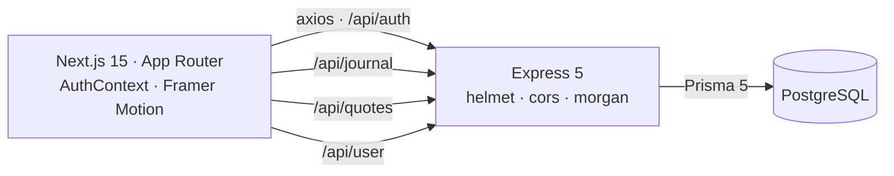

Every other project on this page is trying to do something difficult. This one is trying to do something small, very carefully — and that turned out to be its own kind of difficult.

SoulSpace is a mindfulness app: track how you're feeling, read something worth reading, and watch a small garden grow because you kept showing up. That's the whole product.

## The restraint

The obvious version of a wellness app has streaks, badges, reminders, a social feed and a weekly report card. Every one of those is a well-understood engagement mechanic and every one of them makes the app feel like an obligation.

An app for mental wellness that punishes you for missing three days is doing the opposite of its job.

<Callout type="insight">
The Peace Garden grows when you visit. It does not die when you don't. That single asymmetry is the most important product decision in the project, and it is enforced by the data model: I store a day count and a last-visited timestamp, and there is deliberately nowhere to record a broken streak.
</Callout>

So the feature list is short and stays short:

<TechGrid
  groups={[
    { label: "Features", items: ["Mood journal", "Peace Garden", "Peace Jar", "Reading history", "Ambient player"] },
    { label: "Explicitly not built", items: ["Streaks that break", "Push notifications", "Social feed", "Weekly score", "Leaderboards"] },
  ]}
/>

## The data model

Four tables, and each one exists because a feature needed it:

```
User ──┬── UserStats        dayCount · lastVisited
       ├── JournalEntry     moodLabel · moodEmoji · message · date
       └── ReadingHistory   quoteId · content · author · tags[] · date
```

`UserStats` is the garden. `JournalEntry` is the journal. `ReadingHistory` is what turns the quote jar from a random generator into something with a memory — you can go back and find the line that landed three weeks ago.

<Callout type="note">
One thing I'd fix: journal and history dates are stored as strings rather than as `DateTime`, because it matched what the frontend was already sending. It works today and it will make date-range queries and timezone handling awkward the moment I want either. Convenient at the boundary, expensive in the middle — a trade I now recognise on sight.
</Callout>

## Architecture

A monorepo with a clean split: a Next.js frontend and an Express API, talking over HTTP, with Prisma over PostgreSQL underneath.



Four route groups — auth, user, journal, quotes — each with its own controller. Passwords are bcrypt-hashed, `helmet` sets the security headers, and there's a catch-all error handler so a thrown exception returns JSON instead of an Express stack trace.

The auth middleware is worth a note, because I got the shape of it right by accident and then understood why it mattered. It reads a bearer token, verifies it, attaches the decoded user to the request, and — critically — it's applied with `router.use()` at the top of the journal router rather than being listed per route:

```js
router.use(authenticateToken);   // protects everything below

router.get("/", getEntries);
router.post("/", createEntry);
```

Per-route guards are how endpoints end up unprotected. You add a fifth route six weeks later, forget the middleware argument, and nothing tells you. A router-level guard means a new route is protected by default and you have to actively opt out — which is the direction the mistake should point in. For an app holding people's journal entries, that default is not a small thing.

State on the frontend is a single `AuthContext`. For an app with one authenticated user and four endpoints, reaching for a state library would have been more machinery than the problem justified.

<StatRow>
  <Stat value="4" label="Database models" />
  <Stat value="4" label="API route groups" />
  <Stat value="1" label="React context, no state library" />
</StatRow>

## Making calm feel calm

The hardest part of the frontend was tone, and tone is mostly motion.

**Framer Motion** drives the whole feel, and the rule I held to was that no animation may make the user wait. Transitions ease rather than bounce, the garden grows on a slow curve, and elements enter with opacity and small vertical movement rather than anything that draws attention to itself. A springy, playful animation would be fighting the product.

There's an ambient audio player too, and it's the one feature that isn't strictly necessary — and the one people who tried it commented on most.

Three tracks, served as local media files rather than pulled from an embed, with play/pause, skip, mute and a volume slider. Two of its defaults are the whole point:

- It **docks itself into the corner one second after mount.** It arrives where you can see it, then gets out of the way without being dismissed. It also docks if you click anywhere outside it.
- Volume defaults to **15%**, not 100%. An app about calm should never be the reason someone lunges for the mute key.

Neither of those is clever engineering. Both are the kind of thing that decides whether a wellness app feels considerate or feels like software.

The quote content behind the Peace Jar is two static JSON files in `public/` — a pool of affirmations and a quote-of-the-day set — read directly by the client.

## The pipeline

There's a GitHub Actions workflow that installs both workspaces, lints the frontend, verifies the Prisma client generates cleanly, and builds the frontend to confirm it's deployable.

That last check earns its place. A schema change that generates fine locally but breaks the client in CI is exactly the failure that otherwise gets discovered at deploy time, and the whole run takes under a couple of minutes.

## Getting it running

```bash
cd backend
npm install
npx prisma migrate dev --name init
npm run dev            # :3001

cd ../frontend
npm install
npm run dev            # :3000
```

It needs a PostgreSQL instance, a `DATABASE_URL`, and a `JWT_SECRET`. That's the entire setup, which was also a goal — a project you can't run in five minutes is a project nobody else will ever run.

## What I'd change

The date-as-string decision, first and permanently.

Beyond that: the Peace Garden currently reflects visit count and nothing else. What it should reflect is the journal — a garden that changes with the *shape* of your entries rather than merely their frequency would make the visual actually mean something instead of being a decorated counter. That's the version of this app I'd build next.

And the quote collection stays a static JSON file. That's fine, honestly. It loads instantly, it never fails, and it costs nothing to serve. Not every data source needs a database behind it, and knowing which ones don't is worth as much as knowing how to build the ones that do.

The one thing I would add rather than change: the `ReadingHistory` table records which quotes you've seen but nothing currently uses that to *avoid repeating them*. The data is there. Ten lines of query would make the jar feel like it remembers you, which is exactly the feeling the whole app is reaching for.

SoulSpace is the smallest project here and the one that most changed how I think about scope. Everything else on this page grew until it was hard. This one stayed easy on purpose, and staying easy took more decisions than growing would have.
