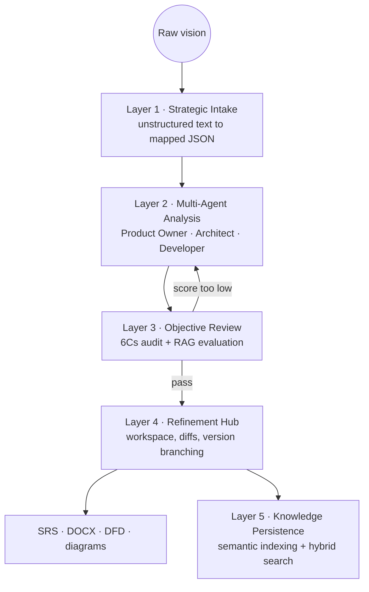

Somewhere in every computer science degree there is a week where you are told to write a Software Requirements Specification. You are handed the IEEE 830 template, told which sections it wants, and left to fill them in. Nobody ever tells you how to write a *good* one — how to notice that "the system should be fast" is not a requirement, or that section 3.2 quietly contradicts section 2.4.

That gap is expensive outside the classroom too. Industry research, including PMI's, puts a large share of project failure — commonly estimated between 30% and 50% — on poor requirements engineering: unclear documentation, semantic ambiguity, stakeholders who thought they agreed and didn't.

SRA is my attempt to treat that as a **quality assurance problem** rather than a documentation problem.

## What it actually does

You give it a paragraph describing what you want to build. It gives you back a specification in one of four standards — IEEE 830-1998, ISO/IEC/IEEE 29148:2018, Volere, or an Agile PRD — with data flow diagrams, a quality score, and a version history.

<StatRow>
  <Stat value="4" label="Specification standards" />
  <Stat value="5" label="Pipeline layers" />
  <Stat value="7" label="Specialised AI agents" />
  <Stat value="4" label="LLM providers" />
</StatRow>

The chosen format is not cosmetic. It is a single descriptor that drives generation, rendering, export and the CLI round-trip end to end — so `sra sync` never writes IEEE's section hierarchy into a Volere document.

## The five-layer pipeline

Everything runs through the same fixed sequence. This was the first real architectural decision, and the one everything else hangs off.



Layer 2 is where the agents live. Rather than one prompt doing everything, there are specialised roles — a Product Owner agent, an Architect agent, a Developer agent — plus a Critic and a Reviewer that exist purely to disagree with the others. They all extend a shared `BaseAgent` that owns timeouts, jittered retries and JSON parsing.

Layer 3 gates the output on the **6Cs of requirements quality**: clarity, completeness, conciseness, consistency, correctness and context. A draft that scores badly goes back to Layer 2 rather than to the user. The same layer runs RAG evaluation for faithfulness and answer relevancy, so a confident-sounding requirement that isn't grounded in the input gets caught.

<Callout type="insight">
The most useful thing I built here wasn't an agent — it was the reflection loop between Layer 3 and Layer 2. An LLM will happily produce a specification that reads beautifully and says nothing. Having a separate scoring pass with the authority to reject and re-run is what makes the output usable.
</Callout>

## The part that took the longest: making it survive

The pipeline is long-running. Early on, closing the browser tab meant losing the work, and a serverless function hitting its execution budget meant a truncated document.

The fix was checkpointing per stage. The pipeline runs entirely server-side on **Upstash QStash**, and an invocation that runs out of budget re-enqueues itself and resumes from the last checkpoint rather than restarting or truncating. That single change is the difference between a demo and something you can leave running.

## Bring your own key, and what that forced

SRA supports Gemini, OpenAI, Claude and Grok through provider adapters. The decision I made — and had to defend to myself repeatedly — is that **generation has no platform-funded fallback**. Every generation-side call runs on the requesting user's own key: generation, the validation gate, auto-fix, alignment, refinement, feature expansion, diagram repair, graph extraction, RAG scoring. All of it.

There is exactly one exception, and it isn't a compromise so much as a consequence of the data model. Embeddings are fixed to Gemini regardless of which provider you pick for generation, because the pgvector columns are one shared embedding space with a fixed dimensionality. You cannot have per-user embedding models and a single vector index at the same time.

That constraint rippled outward in ways I didn't anticipate:

- User keys are **AES-256-GCM encrypted at rest** and never returned in plaintext by the API — only a masked preview goes back to the client.
- The model list offered to a user is discovered **from their key on save**, not hardcoded. You get the models your key can actually call.
- Per-model token ceilings from that discovery step are used to size the generation budget, so the pipeline knows how much room it has before it starts.
- No model ID appears anywhere in `src/`. Every one is read from environment config, so a retired model is an env edit and a restart rather than a code change.

<Callout type="note">
That last one sounds like over-engineering until a provider deprecates a model mid-semester. It happened. It was a one-line change.
</Callout>

## Diagrams that fix themselves

Requirements documents need data flow diagrams, and LLMs generate Mermaid and Gane-Sarson notation with roughly the reliability you'd expect — mostly right, occasionally emitting syntax that won't parse.

Rather than showing the user a broken diagram, there's a repair engine: generated diagram syntax is validated, and failures are routed through a dedicated repair prompt before rendering. The interactive explorer is built on `@xyflow/react` with PNG export for dropping into reports.

## The CLI, and closing the loop

The web app produces specifications. The problem is that specifications go stale the moment code starts moving, which is the actual reason nobody trusts them.

`@sra-srs/sra-cli` exists to close that loop from the other direction:

```bash
pnpm install -g @sra-srs/sra-cli

sra doctor                 # verify setup, credentials and provider keys
sra init                   # link this folder to an analysis
sra reverse                # or: generate a spec from the code already here
sra check --deep --suggest # trace requirements to source
sra push                   # publish traceability back to the platform
```

Two commands matter more than the rest. `sra reverse` reduces an existing codebase to a structural digest — interfaces, entities, module layout, dependencies — runs it through the same multi-agent pipeline, and proposes source links for the requirements it produces. And `sra check --deep` doesn't just confirm that a linked file still exists; it re-checks that the file still carries the requirement's own identifiers, which is how you catch links that rotted as code moved.

## Hardening, because it's deployed

<TechGrid
  groups={[
    { label: "Data", items: ["PostgreSQL 16 + pgvector", "Prisma 7", "HNSW vector index", "Redis"] },
    { label: "Security", items: ["AES-256-GCM field encryption", "PII redaction", "JWT + OAuth", "CSRF middleware", "Audit logging"] },
    { label: "Delivery", items: ["Multi-stage Docker", "Terraform → Vercel", "GHCR images", "CodeQL", "Lighthouse CI"] },
  ]}
/>

Some of this is standard and some of it I only added after it bit me. PII redaction sits in front of the provider call — emails, phone numbers and card-shaped strings are sanitised out of user intent before anything leaves for an external model. Rate limiting is Redis-backed rather than in-process, because in-process limits do nothing once you have more than one instance. Backups are AES-256-GCM encrypted, verified by SHA-256 checksum, and stored in more than one place.

The database schema grew to thirteen models — `Analysis`, `Project`, `KnowledgeChunk`, `GraphNode`, `GraphEdge`, `UserProviderKey`, `ModelQuotaState` and the rest — across a migration history that includes adding pgvector, then adding an HNSW index on top of it once linear similarity search stopped being fast enough.

## What I'd do differently

Two things.

The first is that I chose a shared embedding space early, and it locked me out of per-user embedding providers permanently. If I were starting again I'd dimension the vector column per tenant, or accept multiple indexes, and keep the option open.

The second is scope discipline. SRA is a monorepo with a backend, a frontend, a published CLI, Terraform, an nginx config and four specification format implementations. Every one of those was justified at the time. Collectively they mean the roadmap items I actually want — real-time collaborative multi-user editing, and fine-tuning on the corpus of finalised specs — keep getting pushed behind maintenance.

It is still the project I've learned the most from. Not because of the AI parts, which are the easiest bit, but because building something that has to keep working while a long job runs, a provider rate-limits you and a user closes their laptop is a different discipline entirely.
