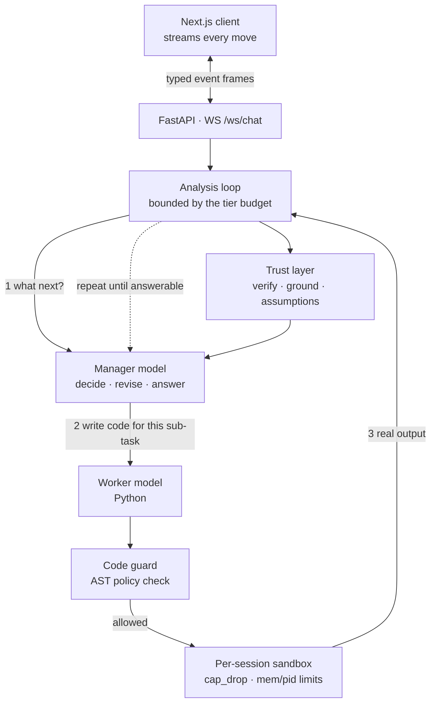

Most "AI data analyst" tools do the same thing: you ask a question, a model writes some pandas, and you are handed code and told it is the answer. Two things are wrong with that. Nobody ran the code, so nobody knows if it works. And the plan was fixed before anything was looked at, which is not how analysis works.

Real analytical questions do not survive contact with the data. You find out the join key is dirty, or that "active customer" means three different things in three tables, only *after* you have looked.

Wizard w1 is built around that observation. It is a local-first autonomous data agent: you upload a file, ask a question in plain language, and it investigates — looking, computing, revising its approach when the data disagrees with it — then verifies the result and explains it, streaming its reasoning as it goes.

<Callout type="note">
It runs entirely on your machine. Your data never leaves it, and no API key is required. Two small Ollama models are enough to be useful.
</Callout>

## The loop that makes it different

There are two models with different jobs. A **manager** works out what to do; a **worker** writes the Python. The code is statically screened, then executed inside a Docker container scoped to your session.

The important part is what happens after execution.

The dotted line is the whole design. Step 3 feeds back into step 1: the manager sees what the code *actually produced* and picks the next move from it. A plan that turns out to be wrong gets rewritten instead of carried out to the end.

Underneath that sits a retry loop. When the sandbox raises, the traceback goes into the worker's prompt and the sub-task is retried up to `MAX_CORRECTION_RETRIES`. A failure that gets successfully repaired is **stored as a counter-example**, so the same mistake is shown back to the model next time a similar question comes up. A sub-task that fails outright isn't fatal either — it's an observation, and the agent can route around it.

## Trusting the answer

An agent that runs code is only half the problem. The other half is that models state numbers confidently whether or not they computed them.

Three mechanisms address that, and they are the features I'm proudest of:

<StatRow>
  <Stat value="2×" label="Headline result recomputed by a second route" />
  <Stat value="600+" label="Tests, no Docker or network needed" />
  <Stat value="7" label="Supported data formats" />
</StatRow>

**Verification.** The headline result is recomputed by a different route. If the two disagree, that disagreement is reported prominently rather than resolved silently.

**Grounding.** Every figure in the answer is traced back to real execution output. Anything that appears in no output at all gets flagged rather than quietly presented as fact.

**Assumptions.** Dropped nulls, inner joins, top-N cuts, coerced dates — the silent decisions that change an answer — are read back **out of the code that actually ran**, not out of the model's description of what it did. Those two things differ more often than you'd like.

Each analysis is also written out as a runnable script, so you can re-run this month's question against next month's data without going through the agent again.

## Sizing itself to the machine

This was the unglamorous work, and it is most of what makes the thing usable on a laptop.

An agent that decides its own next step every iteration is a lot to ask of a very small model. So under 4B parameters it doesn't ask: it runs a shorter deterministic loop — write the code, correct it if it fails, answer — with no self-revision and no verification pass. That's three model calls for a question instead of nine, which is the difference between a minute and twenty. Picking **Deep** in the composer restores the full behaviour at any size.

Resource limits — thread count, sandbox memory, the session cap — are deliberately left unset. They are measured from the physical cores and installed RAM at boot. Setting one pins it, usually badly:

<Callout type="warning">
Local inference is memory-bandwidth bound, so more threads than *physical* cores is contention, not throughput. Eight threads on a four-core laptop is slower than four. This is the single most common reason a question takes twenty minutes, and the fix is deleting a line from `.env`.
</Callout>

There's a second sizing decision that surprised me. The manager and worker alternate several times per question, so what matters is whether both fit in RAM *at once*. Two 7B models want roughly 14 GB; a 16 GB laptop running a browser and a sandbox does not have that. Wizard measures them and decides: if they fit, both stay resident; if they don't, each is released after it runs. That costs one reload per step — but it avoids two oversized models paging each other to disk, which is one to two orders of magnitude worse and takes the rest of the desktop down with it.

## Running untrusted code

Generated code is untrusted code. Three layers apply.

1. **Static analysis** — an AST policy check rejects restricted imports, dynamic execution, interpreter-internals traversal, reflection with computed attribute names, and file access outside the workspace. Malformed code is treated as *retryable* rather than hostile, so the model gets to fix its own typo.
2. **Process isolation** — one Docker container per session with `cap_drop=ALL`, `no-new-privileges`, memory and PID limits, and a per-execution timeout. Set `SANDBOX_DOCKER_RUNTIME=runsc` for gVisor kernel isolation.
3. **Scoped filesystem** — each session reads and writes only its own workspace directory.

Docker is recommended but **not required**, which was a deliberate call. Without it, code runs in a subprocess per session: its own memory ceiling, a per-step timeout, a Stop button that actually works, and variables that persist between steps. Same behaviour, no image to build.

I am careful about how I describe that mode, though. It is not a security boundary — the subprocess runs as you, with your files. It contains runaway code; it does not contain hostile code. Use Docker for data or questions you didn't write yourself.

<Callout type="warning">
The backend mounts the host Docker socket so it can create sandbox containers. That is host-root-equivalent access. Wizard is designed for a trusted machine, and exposing it beyond localhost means setting `API_KEY` and a narrow CORS allowlist first.
</Callout>

## Degrading honestly

The design rule I applied hardest across the whole project: **nothing silently pretends**.

No embedding model installed? Semantic retrieval falls back to word overlap, and the settings page says "Word overlap" rather than implying it's doing something smarter. Model unreachable? You get a clear message, not a hang. Docker missing? The settings page says "Local subprocess", not "Docker container". A smaller sandbox image means the model is *told* it has a smaller toolkit, so it narrows what it writes rather than emitting code that fails to import.

That principle is also why the sandbox ships in tiers — `core`, `standard`, `full` — instead of one image that either fits your disk or doesn't.

## Where it stands

The analytical surface is wider than pandas: DuckDB for SQL over dataframes, statsmodels and scipy for inference, scikit-learn/XGBoost/LightGBM for modelling, lifelines for survival analysis, networkx for graphs, geopandas for spatial. Data comes in as CSV, TSV, Excel, JSON, NDJSON, Parquet or Feather. Reference documents — data dictionaries, metric definitions, business rules — can be attached as Markdown, text, PDF or `.docx`, and the agent consults them mid-analysis when a question turns on what a column *means*.

The test suite is 600+ tests organised as `unit/`, `integration/`, `regression/` and `negative/`, and none of them need Docker, a model, a network or a subprocess to run. The regression suite pins previously-fixed defects and each test explains what broke, which has saved me more than once when refactoring the session layer.

What I'd change: the manager/worker split is the right idea, but I bolted the depth tiers on afterwards rather than designing for them, and the tier logic is now threaded through more of the loop than I'd like. Next time that's a first-class concept from day one.
